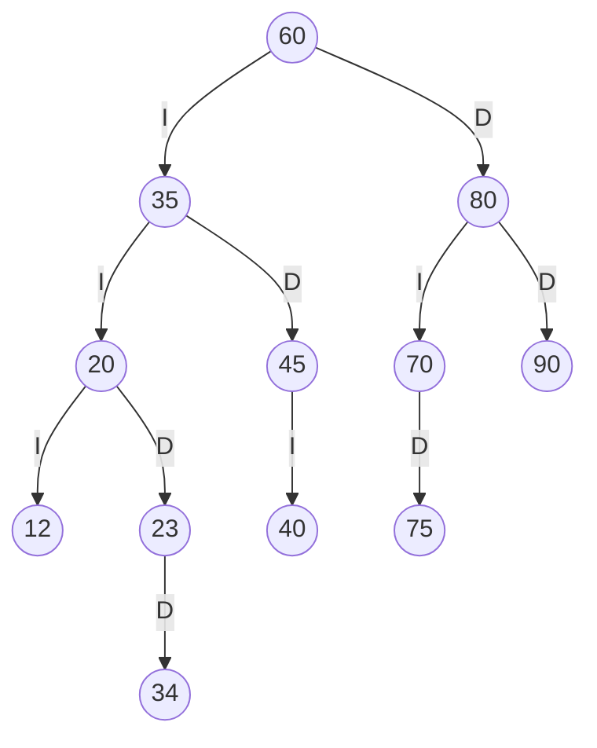
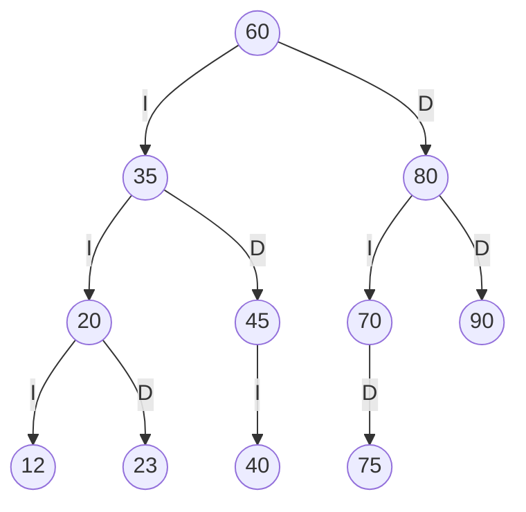
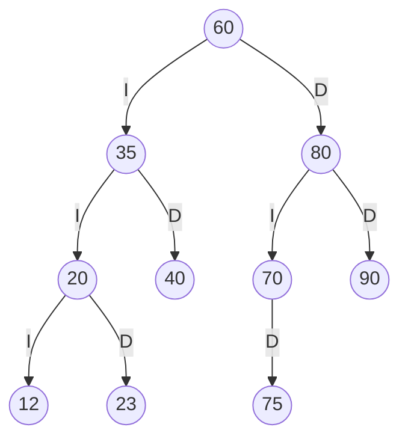
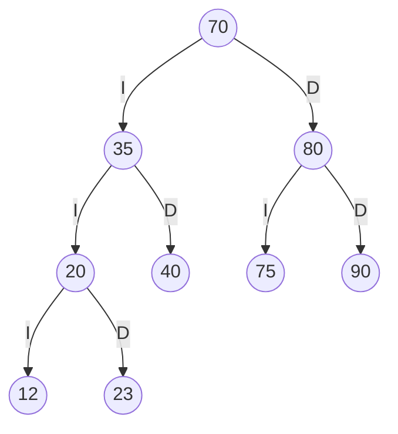

# TRAZAS.md — Resolución a mano y comparación con el programa

> **Importante:** los tres códigos personales de abajo usan los dígitos de ejemplo `1234`.
> Antes de entregar, cámbialos por los **4 últimos dígitos de tu cédula** y rehaz las secciones 1 a 5
> (el programa te sirve para comprobar tu resultado a mano).

## 1. Códigos personales

Cédula terminada en `abcd = 1234` → `ab = 12`, `bc = 23`, `cd = 34`.
Ninguno es 0, ninguno se repite y ninguno existe ya en SW-E1 (60, 35, 80, 20, 45, 70, 90, 40, 75),
así que no hay que sumar 1 a ninguno.

## 2. Inserción paso a paso en SW-E1

Regla: menor que el nodo → izquierda; mayor → derecha.

| Paso | Código | Camino seguido | Queda como |
|---|---|---|---|
| 1 | 60 | raíz vacía | raíz |
| 2 | 35 | 60 → I | hijo izq. de 60 |
| 3 | 80 | 60 → D | hijo der. de 60 |
| 4 | 20 | 60 → I, 35 → I | hijo izq. de 35 |
| 5 | 45 | 60 → I, 35 → D | hijo der. de 35 |
| 6 | 70 | 60 → D, 80 → I | hijo izq. de 80 |
| 7 | 90 | 60 → D, 80 → D | hijo der. de 80 |
| 8 | 40 | 60 → I, 35 → D, 45 → I | hijo izq. de 45 |
| 9 | 75 | 60 → D, 80 → I, 70 → D | hijo der. de 70 |
| 10 | 12 | 60 → I, 35 → I, 20 → I | hijo izq. de 20 |
| 11 | 23 | 60 → I, 35 → I, 20 → D | hijo der. de 20 |
| 12 | 34 | 60 → I, 35 → I, 20 → D, 23 → D | hijo der. de 23 |

## 3. ABB final tras insertar la secuencia de SW-E1 y los tres c?digos personales



## 4. Recorridos y traza del preorden

| Recorrido | Resultado a mano | Salida del programa | ?Coincide? |
|---|---|---|---|
| PREORDEN | `60 35 20 12 23 34 45 40 80 70 75 90` | `60 35 20 12 23 34 45 40 80 70 75 90` | ? Coincide |
| INORDEN | `12 20 23 34 35 40 45 60 70 75 80 90` | `12 20 23 34 35 40 45 60 70 75 80 90` | ? Coincide |
| POSORDEN | `12 34 23 20 40 45 35 75 70 90 80 60` | `12 34 23 20 40 45 35 75 70 90 80 60` | ? Coincide |

Traza del preorden (salida del programa):

```text
entra 60
VISITA 60
  entra 35
  VISITA 35
    entra 20
    VISITA 20
      entra 12
      VISITA 12
        null -> regresa
        null -> regresa
      entra 23
      VISITA 23
        null -> regresa
        entra 34
        VISITA 34
          null -> regresa
          null -> regresa
    entra 45
    VISITA 45
      entra 40
      VISITA 40
        null -> regresa
        null -> regresa
      null -> regresa
  entra 80
  VISITA 80
    entra 70
    VISITA 70
      null -> regresa
      entra 75
      VISITA 75
        null -> regresa
        null -> regresa
    entra 90
    VISITA 90
      null -> regresa
      null -> regresa
Secuencia PREORDEN: 60 35 20 12 23 34 45 40 80 70 75 90
```

## 5. Eliminaciones (sobre el ?rbol anterior, en este orden)

### 5.1 Eliminar 34 (hoja)

Preorden a mano: `60 35 20 12 23 45 40 80 70 75 90`  
Preorden del programa: `60 35 20 12 23 45 40 80 70 75 90`  
Resultado: ? Coincide



### 5.2 Eliminar 45 (un hijo)

Preorden a mano: `60 35 20 12 23 40 80 70 75 90`  
Preorden del programa: `60 35 20 12 23 40 80 70 75 90`  
Resultado: ? Coincide



### 5.3 Eliminar 60 (dos hijos)

Preorden a mano: `70 35 20 12 23 40 80 75 90`  
Preorden del programa: `70 35 20 12 23 40 80 75 90`  
Resultado: ? Coincide



Explicación de la eliminación de dos hijos (60): el sucesor inorden es el menor del subárbol derecho.
Se baja por 80 → 70 (70 no tiene hijo izquierdo), por lo que 70 es el sucesor. Su valor reemplaza al 60
y el nodo 70 original se elimina: como solo tenía hijo derecho (75), el 75 ocupa su lugar como hijo izquierdo de 80.

## 6. Resumen de coincidencias

Todas las salidas del programa coinciden con la resolución a mano (ver columnas "¿Coincide?").
